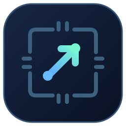

# LLM Launcher

<p align="center">
  
</p>

Run a local language model with Docker Compose. LLM Launcher checks your hardware, shows compatible models for your task, and starts the one you choose with Ollama, vLLM, or llama.cpp. Once the model answers a test request, the launcher prints the local API URL and model name.

## Download

| Platform | File |
| --- | --- |
| Windows x64 | [Desktop app](https://github.com/sunshard-ai/llm-launcher/releases/latest/download/LLM-Launcher-Windows-x64.exe) · [CLI](https://github.com/sunshard-ai/llm-launcher/releases/latest/download/llm-launcher-windows-amd64.exe) |
| Linux x64 | [CLI](https://github.com/sunshard-ai/llm-launcher/releases/latest/download/llm-launcher-linux-amd64) |
| Linux ARM64 | [CLI](https://github.com/sunshard-ai/llm-launcher/releases/latest/download/llm-launcher-linux-arm64) |
| macOS Apple Silicon | [CLI](https://github.com/sunshard-ai/llm-launcher/releases/latest/download/llm-launcher-darwin-arm64) |

[All releases, source archives, and checksums](https://github.com/sunshard-ai/llm-launcher/releases)

## Start a model

Start Docker with Compose v2 and Linux containers. For NVIDIA on Linux, install the NVIDIA driver and Container Toolkit. On Windows, run Docker Desktop with the WSL2 backend. [NVIDIA Container Toolkit](https://docs.nvidia.com/datacenter/cloud-native/container-toolkit/latest/install-guide.html) · [Docker Desktop GPU support](https://docs.docker.com/desktop/features/gpu/)

**Linux x64.** Run these commands in the download directory, then choose a task and a model. The first launch downloads the runtime image and weights. The launcher saves the deployment under `./runs/<model-id>` by default.

```bash
chmod +x llm-launcher-linux-amd64
./llm-launcher-linux-amd64 scan
```

**Windows x64.** Open `LLM-Launcher-Windows-x64.exe`. The desktop app starts in English. Use the language menu in the top right to switch to Deutsch, Русский, 简体中文, or Français. Scan your PC, select a task and a model, then prepare and launch the plan. [Windows walkthrough](docs/USAGE.md#windows-desktop) · [SmartScreen and download verification](docs/TROUBLESHOOTING.md#windows-smartscreen)

**Linux ARM64 or macOS Apple Silicon.** Make the downloaded binary executable, then run it with `wizard --dir ./my-model`. Both platforms use CPU containers in this release. On Linux and macOS, use `--help` for the English command list or `COMMAND --help` for a command’s options.

## Models and hardware

The catalog has 52 profiles covering chat, coding, answers using supplied context, and embeddings. A model can have separate profiles for different engines and weight formats. GPU recommendations use free memory on one NVIDIA card. The 4–128 GiB range was tested with simulated hardware. Qwen3 0.6B was run in llama.cpp on CPU in Docker. [Model selection guide](docs/MODELS.md) · [Test results](docs/BUILD_REPORT.md)

The launcher includes a model catalog and checks for signed updates in the background when you open the desktop app or interactive wizard. [How updates work](docs/MODELS.md#update-the-catalog)

## Documentation

- [User guide](docs/USAGE.md) for CLI and Windows setup, Hugging Face imports, advanced settings, API calls, and weight storage.
- [Troubleshooting](docs/TROUBLESHOOTING.md) for Docker, CUDA, memory, and download errors.
- [Build and test](docs/TESTING.md) for development checks, release packaging, and hardware verification.

## License

The launcher code is released under the [MIT License](LICENSE). Runtime images and model weights retain their own licenses. Check the upstream repositories for runtime licenses and the [model catalog](catalog.json) for model licenses.
