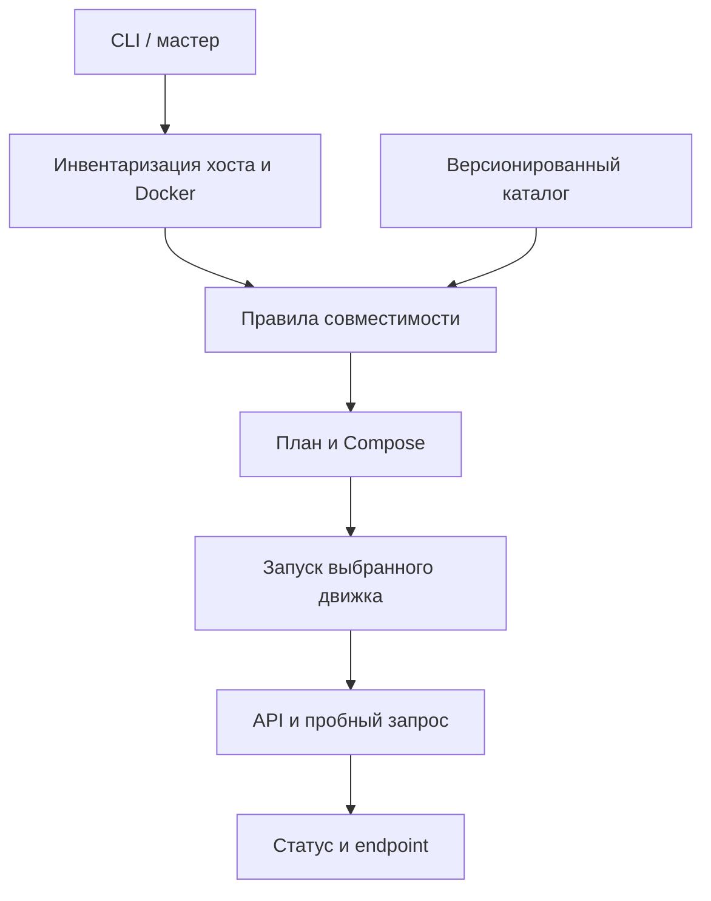

# План разработки LLM Launcher

Редакция для Linux и Windows/WSL2, 6 ноября 2026 года.

## 1. Результат для пользователя

Пользователь запускает бинарник, видит конфигурацию компьютера, выбирает задачу и один из подходящих вариантов. До скачивания ему показываются движок, модель, контекст, устройство и адрес API. После подтверждения launcher разворачивает сервис и проверяет ответ выбранной модели. Пользователь получает endpoint и команды управления.

Критерий успешного запуска — не работающий процесс Docker, а валидный ответ нужной модели через ожидаемый API. Для embeddings критерием служит непустой числовой вектор.

### Границы первой версии

| Уже заложено в прототип | Следующие версии |
| --- | --- |
| Go CLI, терминальный мастер и предварительный Windows EXE | Аппаратная квалификация, подпись и выпуск Windows EXE |
| Сканирование Linux / Windows / macOS | Более точная диагностика WSL, NUMA, RAM контейнера, дисков Docker |
| Ollama и llama.cpp на CPU/NVIDIA, vLLM на NVIDIA | AMD ROCm/Vulkan, Intel, Apple Metal, нативные backends |
| Подписанный [каталог текстовых моделей и эмбеддингов](MODELS.md) | Vision, speech, reranker, специализированные модели |
| Одна модель и одна GPU на проект | Несколько моделей, multi-GPU, несколько реплик |
| Сохранённый план, Compose, список, архив и управление сервисом | Хранилище весов по выбору, наблюдение, обновления и откат |
| Проверка реального ответа | Benchmark и подбор по измеренным данным |

Windows EXE управляет Ollama, vLLM и llama.cpp в локальных Linux-контейнерах Docker Desktop/WSL2. В каталоге для llama.cpp доступны CPU и NVIDIA, ручной импорт GGUF использует CPU. [Источники](SOURCES.md).

## 2. Архитектура

### Слои и ответственность

| Компонент | Данные и действия | Граница ответственности |
| --- | --- | --- |
| `hardware` | CPU, RAM, GPU, Docker, доступное место | Наблюдает; не устанавливает драйверы |
| `catalog` | Идентификаторы, формат весов, задачи, лицензии, оценки ресурсов | Не исполняет код из внешнего каталога |
| `recommend` | Фильтрация и ранжирование профилей с объяснением | Не выдаёт оценку ресурсов за benchmark |
| `domain` | Схемы JSON для инвентаризации, плана и состояния | Изменения схемы требуют версии и миграции |
| `deploy` | Compose, ограниченные вызовы Docker, API-проверки | Управляет только собственным проектом |
| CLI и Windows GUI | Выбор пользователя, отображение причин и ошибок | Общие команды и правила подбора |

В первой версии внешние Go-зависимости не нужны. Работа с ОС выполняется стандартной библиотекой и ограниченными вызовами системных команд. Docker вызывается через массив аргументов; данные пользователя не преобразуются в shell-команды.

Для расширения движков выделяется единый контракт: `Capabilities`, `Validate`, `Render`, `Start`, `Ready`, `Smoke`, `Status`, `Stop`. Этот контракт следует извлечь из работающих реализаций Ollama и vLLM, когда появится третий backend; преждевременная универсальная система плагинов не нужна.

## 3. Правила подбора

### Сначала совместимость

Проверяется сочетание `OS → CPU architecture → Docker backend → accelerator → driver → runtime image → model format`. Похожее название GPU или достаточный общий объём памяти не заменяют проверку совместимости.

Примеры важных ограничений:

- На Windows GPU в выбранном Docker-пути требует WSL2 и поддерживаемой NVIDIA.
- Apple GPU не становится CUDA-устройством внутри стандартного контейнера Ollama.
- Для первой матрицы vLLM используется Linux x86-64 и NVIDIA с compute capability от 7.5.
- Несколько GPU не образуют автоматически один общий пул VRAM.
- Удалённый Docker context нельзя оценивать по железу локального компьютера; локальный MVP его не обслуживает.

Более широкие возможности самих движков не означают, что они уже квалифицированы в launcher. [Источники S1–S4](SOURCES.md).

### Затем ресурсы

Начальный профиль использует ограниченный контекст и одну параллельную последовательность. Для GPU резерв включает веса, KV-cache, рабочие буферы и запас. Для CPU учитываются доступная RAM, резерв ОС и лимит Docker VM. Если свободную VRAM узнать не удалось, неизвестное значение не подменяется общим объёмом карты.

Значения `min_ram_gib`, `min_vram_gib` и `disk_gib` в каталоге — инженерные оценки. Они должны улучшаться по результатам полевых тестов. Для длинного контекста, мультимодальности, MoE и нескольких пользователей потребуются отдельные профили.

Диск имеет два независимых ограничения: место в каталоге проекта и место в Docker-хранилище. Текущий локальный замер покрывает первое; в следующей итерации нужен отдельный доступный, переносимый способ проверить второе. Размер скачиваемого файла не равен пиковому месту при загрузке и распаковке.

### Затем предпочтения

Пользователь выбирает назначение: общение, код, генерация для RAG или embeddings. В будущем добавляются предпочтения «минимум ресурсов», «быстрее» и «выше качество». Эти режимы должны опираться на измерения и описанные критерии, а не на обещание, что самая большая помещающаяся модель всегда лучше.

Рекомендация показывает причины: выбранная GPU, свободная память, размер стартового контекста, возможный CPU-режим, ресурсный запас и ограничения модели. Профиль, не прошедший обязательную проверку, не должен появляться как готовый к запуску.

## 4. Контракт запуска

Последовательность действий:

1. Собрать текущую инвентаризацию и показать ограничения.
2. Создать план, проверить значения, сохранить Compose и служебную метаинформацию.
3. Перед запуском проверить сохранённый план, принадлежность проекта и актуальность предпосылок.
4. Проверить Compose, получить Docker-образ, убедиться в доступности выбранной GPU контейнеру.
5. Запустить сервис и дождаться API.
6. Для Ollama получить выбранные веса; для vLLM дождаться завершения загрузки модели.
7. Выполнить текстовый или embedding-запрос и проверить содержимое ответа.
8. Только после этого показать успешное завершение и endpoint.

Ошибка на любом шаге должна содержать этап, конкретную причину и следующую команду диагностики. Частичная загрузка и тома не удаляются автоматически. После отмены пользователь проверяет `status` и при необходимости выполняет `down` для своего проекта.

### Управляемость

`status` показывает наблюдаемое состояние; `test` выполняет проверку инференса; `logs` даёт сообщения движка; `down` сохраняет веса; `up` повторно запускает сохранённый профиль. Существующие сервисы, драйверы, firewall и настройки Docker не изменяются ради старта нового проекта.

Версии образов фиксируются явными тегами. Тег реестра и модельный tag могут быть изменены издателем, поэтому это ещё не полная воспроизводимость. Для следующего уровня нужны image digest, revision весов, digest модели Ollama, версия каталога и правила обновления. Сведения об уже использованном образе полезно фиксировать в отчёте запуска; нельзя обещать неизменяемость только потому, что в имени есть номер версии.

## 5. Спринты

Оценка — ориентир для небольшой команды или одного разработчика с агентами. Продолжительность зависит прежде всего от доступности машин для GPU- и Windows-тестов. Этапы можно выполнять последовательно по 3–5 рабочих дней; аппаратную квалификацию стоит начинать сразу.

### Спринт 0. Прототип и первый реальный запуск

**Цель:** пройти основной пользовательский путь на одном компьютере.

Работа: CLI, сканер, встроенный каталог, объяснимый отбор, генератор Compose, запуск и пробный запрос. Собрать бинарники для целевых ОС и добавить инструкции.

**Definition of Done:**

- Исходники собираются без внешних Go-модулей.
- Тесты проверяют неправильную платформу, нехватку ресурсов, неизвестную VRAM и ошибки API.
- Мастер умеет подготовить план без скачивания.
- На выбранном реальном стенде модель отвечает, останавливается и запускается снова с сохранённым томом.
- В отчёте отделены автоматические проверки от аппаратно подтверждённых сценариев.

Текущий архив закрывает реализацию прототипа. Аппаратный DoD этого этапа завершается первым тестом пользователя и фиксацией результатов.

### Спринт 1. Квалификация и восстановление после ошибок

**Цель:** предсказуемый запуск на типовых машинах.

Работа: тестовые стенды Ubuntu CPU, Ubuntu NVIDIA, Windows NVIDIA/WSL2; уточнение запаса RAM/VRAM; проверка занятого порта; потеря сети; OOM; медленная загрузка; повреждённый план; повторный `up`; параллельные запуски.

**Definition of Done:**

- Для каждого поддержанного сочетания зафиксированы ОС, Docker, драйвер, GPU, образ, модель и результаты теста.
- Отмена не повреждает веса и не затрагивает соседние проекты.
- Нехватка ресурсов или ошибка драйвера дают понятную диагностику.
- Публичная таблица совместимости различает «проверено», «экспериментально» и «недоступно».
- Есть ограниченный по объёму диагностический пакет с просмотром содержимого перед отправкой.

### Спринт 2. Каталог и измеримый подбор

**Цель:** рекомендации, которые можно объяснить и воспроизвести.

Работа: схемы каталога, `runtime ↔ model` matrix, image digest/revision, ручное обновление каталога, benchmark TTFT/скорости/памяти, профили контекста и памяти, лицензии моделей.

**Definition of Done:**

- Каталог проходит структурную и семантическую проверку до использования.
- Непроверенная новая запись не наследует автоматически статус проверенной.
- Benchmark запускается отдельно по запросу, а результаты содержат параметры и ограничения стенда.
- Повторное развёртывание по зафиксированным digest/revision использует тот же артефакт.
- Для качества моделей указан набор задач и метод оценки, а скорость не выдаётся за качество.

### Спринт 3. Windows EXE и хранение

**Цель:** путь «открыл → выбрал → получил адрес» без ручного ввода команд.

Предварительный Windows x64 EXE использует Windows Forms и общие команды CLI. В нём есть выбор задачи, движка и GPU, проф. настройки для выбранной модели, импорт Hugging Face, сводка с отдельным окном Compose и вкладка управления. Следующий шаг — пройти этот путь на Windows и измерить задержку интерфейса при скачивании и отмене. Затем разделить в мастере папку проекта и место хранения весов.

**Definition of Done:**

- GUI вызывает те же сервисы и схемы плана, что CLI.
- В интерфейсе видно, чего не хватает: Docker, драйвера, RAM, VRAM или сети.
- Можно отменить процесс и продолжить диагностику без закрытия приложения.
- Установщик и подпись Windows-бинарника проверены отдельно от компиляции.
- CLI остаётся доступным для серверов и автоматизации.

### Спринт 4. Несколько GPU и движки

**Цель:** расширить парк оборудования по проверенным путям.

Первый профиль нескольких GPU — vLLM tensor parallel на одном Linux x86-64 сервере с двумя совместимыми NVIDIA GPU. Далее проверить тот же профиль под Windows/WSL2 как отдельную конфигурацию, затем добавить профили Ollama и llama.cpp. SGLang и Docker Model Runner входят в следующую очередь адаптеров. AMD, Intel и Apple GPU квалифицируются отдельными профилями.

| Движок | Что показывать в рекомендации после квалификации |
| --- | --- |
| Ollama | Tag, контекст, параллелизм, выбранные устройства, режим размещения и наблюдаемое использование GPU |
| vLLM | Revision, dtype/квантование, контекст, лимит последовательностей, долю VRAM, TP/PP и точный состав GPU |
| llama.cpp | GGUF и его checksum, контекст, число слоёв на GPU, режим и доли разделения модели |
| SGLang | Revision, dtype/квантование, контекст, статический бюджет памяти, TP и проверенную версию CUDA-образа |
| Docker Model Runner | OCI-артефакт, поддерживаемый backend, лимиты контекста и способ запуска через Docker Model Runner |

В мастере отдельно выбираются **одна модель на нескольких GPU**, **реплики на разных GPU** и **разные модели на разных GPU**. Шардинг проверяет бюджет каждой карты с учётом распределения весов, KV-cache, буферов и обмена между картами. Реплика должна целиком помещаться в свой набор GPU. Для первого профиля TP выбирается проверенная конфигурация одинаковых GPU; разнородные устройства, PP и несколько серверов получают отдельные проверки. Проверка после старта сопоставляет фактические устройства с планом и выполняет запрос к модели.

План версии 2 хранит проф. настройки и закреплённые артефакты Hugging Face. Планы версии 1 продолжают запускаться существующим путём. Изменение настроек требует создания нового проверяемого плана. Схема будущих multi-GPU профилей должна явно хранить режим распределения, состав устройств и параметры движка. Первичные источники по движкам и GPU перечислены в [SOURCES.md](SOURCES.md#несколько-gpu-и-дополнительные-движки).

**Definition of Done:**

- Появление backend в интерфейсе зависит от успешных обязательных проверок.
- Учитываются особенности памяти, версии драйверов и доступные устройства каждой платформы.
- Для multi-GPU проверены topology, параллелизм, неодинаковые карты и отказ одной карты.
- Нет универсального «GPU=true», скрывающего несовместимые способы запуска.

### Спринт 5. Продакшен на одном Linux-сервере

**Цель:** управляемая локальная платформа.

Для одиночного хоста Compose остаётся стандартным вариантом для контейнерных движков. Launcher проверяет `compose config`, закрепляет UUID устройств и показывает порт и тома до запуска. Docker Model Runner и нативные движки получают собственный способ запуска и единый экран состояния. Для нескольких хостов нужен отдельный способ оркестрации и проверка ресурсов целевых серверов.

Пользователь выбирает папку плана и отдельно хранилище весов: управляемый том Docker, подтверждённый bind mount или подключение к уже загруженным весам. Перед скачиванием проверяются место, права и доступность пути из контейнера. Для Windows тестируются путь с пробелами и кириллицей, отдельный диск и файловая система WSL2. `delete` архивирует проект; удаление весов потребует отдельной операции с предварительным просмотром и проверкой ссылок других проектов.

Добавить `watch` для живых этапов загрузки, старта и готовности, `restart` для управляемого перезапуска, `inspect` для плана и digest. Разделять последнее сохранённое состояние в `list` и живые проверки в `status`. Для продакшена добавить резервирование GPU между проектами, метрики задержки/очереди/VRAM, контроль перезапусков, журнал операций, закреплённые версии, обновление и откат. Сетевой профиль включает аутентификацию, TLS и явный выбор интерфейса. Базовый профиль публикует только loopback.

**Definition of Done:**

- Обновление создаёт проверяемый новый план и не заменяет рабочий до успешного теста.
- Если параллельный запуск старой и новой версии не помещается, интерфейс заранее сообщает о необходимом перерыве.
- Откат восстанавливает конкретный прежний профиль и артефакты.
- Удаление весов — отдельное явное действие со списком затронутых проектов.
- Внешний доступ нельзя включить без настроенного способа аутентификации.

## 6. Поддержка и выпуск версий

Каталог и код выпускать независимо только после появления совместимых версионированных схем. До этого — единый архив с версией, контрольными суммами и протоколом тестирования. Новая версия движка не должна автоматически попадать в пользовательский `up` через тег `latest`.

Перед выпуском проверить компиляцию всех заявленных бинарников, unit/integration-тесты, хотя бы один реальный CPU- и один GPU-путь, сценарии `up → test → down → up`, обновление и документацию. При отсутствии нужного стенда оставить соответствующий профиль экспериментальным.

Для уже установленной модели хранить план и Compose, сведения о версии launcher и каталога, образе/модели, успешном тесте и ошибках последней операции. Не добавлять в диагностический пакет токены, пользовательские запросы или полные файлы окружения без явного выбора пользователя.

## 7. Риски, которые нужно закрыть измерениями

| Риск | Как обнаруживаем | Что делаем |
| --- | --- | --- |
| Модель помещается по весам, но не по KV-cache | Пробный запрос и измерение пика памяти | Ограничиваем контекст, уточняем профиль |
| В ОС GPU видна, в контейнере — нет | Контейнерный probe и инференс | Диагностика драйвера/toolkit/WSL |
| Docker VM получила меньше памяти, чем хост | `docker info` и наблюдение запуска | Учитываем лимит при подборе |
| Закончился диск Docker | Сообщения загрузки и проверка data root | Диагностика диска, без автоматической очистки |
| Tag образа или модели изменился | Сравнение digest/revision | Переход к зафиксированным артефактам |
| Выбран удалённый Docker context | Проверка endpoint | Локальный MVP отказывает, отдельный remote backend позже |
| Ошибка рейтинга моделей | Калибровочные задачи и обратная связь | Обновляем каталог с объяснением изменения |
| Порт занят существующим сервисом | Проверка до публикации | Выбираем другой порт или останавливаем свой проект |

## 8. Первый тест с владельцем компьютера

Сначала выполнить `scan --json` и проверить правильность CPU/RAM/GPU. Затем пройти `wizard --dry-run`, изучить предложенную конфигурацию и запустить её через `up`. Зафиксировать время загрузки, адрес API, результат `test` и фактическое использование GPU. После `down` повторить `up` и убедиться, что веса сохранились. Подробные команды — в [TESTING.md](TESTING.md).
